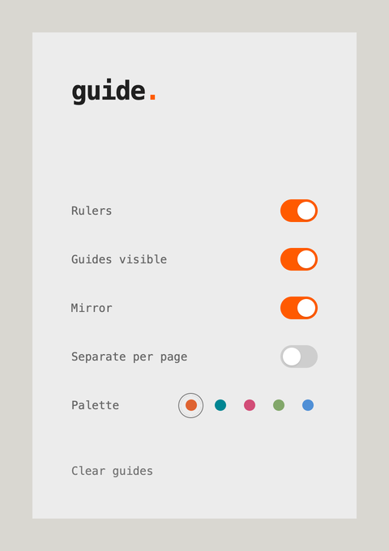

# guide.

Guides and rulers for any web page. A Chrome extension for lining things up: margins, columns and alignment on live sites.

## What it does

- **Guides** you drag out of either ruler. Drag from the corner square to place a horizontal and a vertical guide together.
- **Rulers** along the top and left edges, in CSS pixels, that follow the page as you scroll.
- **Exact positions.** Hold Shift to snap to every 10 px. Double-click a guide to type its position.
- **Mirror.** With Mirror on, each new guide gets a twin at the same distance from the opposite document edge, which makes equal margins easy. Alt-click any guide to mirror it once.
- **Shading.** Guides get slightly darker towards the edges of the page, so you can tell the outer ones from the inner ones at a glance.
- **Palettes.** Orange, Cyan, Pink, Green or Blue.
- **Guides stay put.** They are saved and shared across pages, or kept per page if you turn on *Separate per page*. Turning the rulers off leaves your guides on screen.

 

## Install

1. Download or clone this repository.
2. Open `chrome://extensions` and turn on **Developer mode**.
3. Click **Load unpacked** and choose this folder.
4. Pin Guide from the puzzle-piece menu.

After an update, click the reload arrow on Guide's card in `chrome://extensions`.

## Shortcuts

| Keys | Action |
| --- | --- |
| `Alt+R` | Rulers on or off |
| `Alt+Shift+R` | Show or hide guides |
| `Alt+Shift+C` | Clear all guides |
| `Alt+M` | Mirror on or off |

Change them at `chrome://extensions/shortcuts`.

## Using guides

- Drag a guide to move it. Drag it back onto its ruler to remove it.
- Double-click a guide to type its CSS-pixel position in a small field on the line. Enter applies the value; Escape dismisses it.
- Two guides dropped on the same pixel merge into one.
- With **Mirror** on, each new guide is paired with its twin at the opposite edge. Alt-click a guide to mirror it once; paired guides move together, and deleting one leaves the other independent.
- Vertical mirror edges are `0` and `documentElement.scrollWidth`; the scrollbar gutter is excluded. Horizontal mirror edges are `0` and `documentElement.scrollHeight`.
- Rulers can be turned off while guides stay visible and continue to reach the page edges.
- Guides use page coordinates, so they stay on the same spot of the page when you scroll.

## Development

Plain JavaScript, no build step: `content.js` draws the rulers and guides, `popup.html` / `popup.css` / `popup.js` are the dropdown, and `background.js` handles the shortcuts. `demo/index.html` is the page in the screenshot; `test/index.html` and `test/second.html` are for trying guides across pages.
